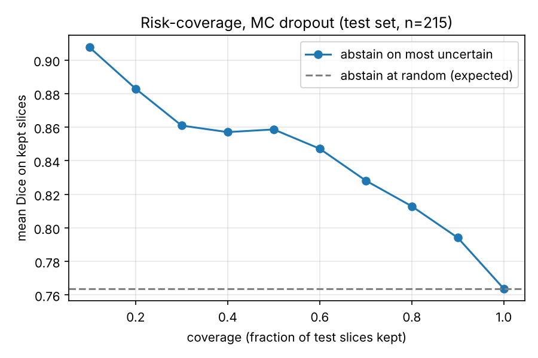
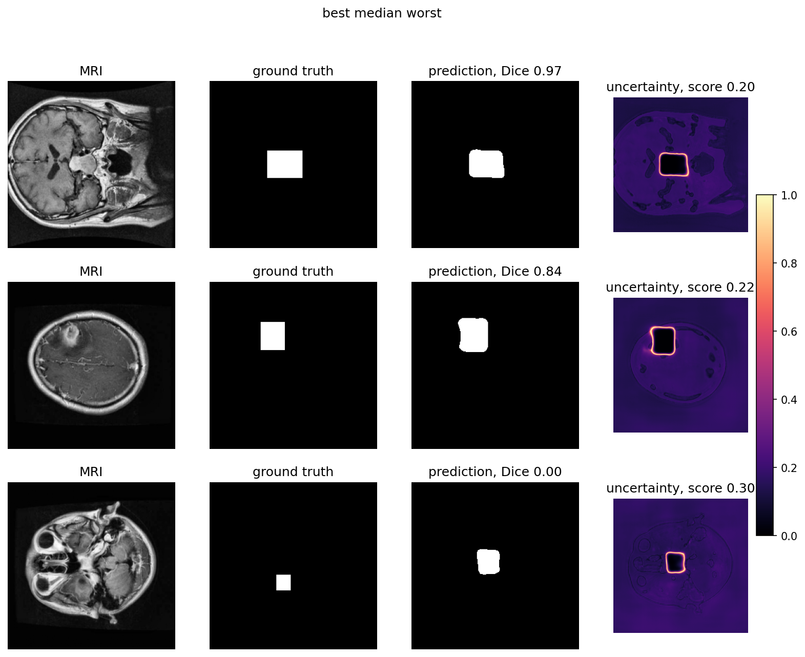
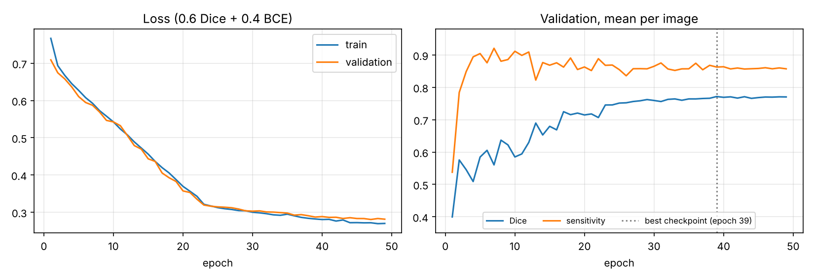

# Computer Vision: Deep Learning Projects

This repo has two computer vision projects. The first classifies plant diseases from leaf photos. The second segments brain tumours in MRI slices and estimates how uncertain the model is about each segmentation. Both started in the Computer Vision and AI module of my M.Sc. in Data Analytics. I later rebuilt the MRI project in PyTorch and added uncertainty estimation.

## 1. Brain tumour segmentation on MRI (PyTorch, with uncertainty)

Notebook: [`notebooks/mri_segmentation_pytorch.ipynb`](notebooks/mri_segmentation_pytorch.ipynb)

This is a 2D U-Net that segments tumours in MRI slices. The data is the [Brain Tumor Image DataSet: Semantic Segmentation](https://www.kaggle.com/datasets/pkdarabi/brain-tumor-image-dataset-semantic-segmentation) from Kaggle: 2,146 slices with COCO-format masks, split into 1,502 for training, 429 for validation and 215 for testing.

**Model and training**

* U-Net with 5 levels (32 to 512 filters), a 1,024-filter bottleneck, batch norm and dropout.
* Loss: 0.6 × soft Dice + 0.4 × binary cross-entropy. Optimiser: Adam with ReduceLROnPlateau, plus early stopping on validation Dice.
* Augmentation runs on the GPU: flips, rotation, elastic deformation, brightness/contrast and Gaussian noise. The image and mask are transformed together, and the mask stays binary.

**Evaluation**

* Dice, IoU, sensitivity and precision are computed per image and also pooled over all test pixels. Slices with a tumour are reported separately from slices without one.
* The notebook also reports the false-alarm rate on tumour-free slices and how often a tumour is missed completely.

**Uncertainty**

* Monte Carlo dropout uses 20 stochastic passes per image. Each pass is a full prediction, and together they give a pixel-wise uncertainty map and a per-image uncertainty score.
* The notebook checks whether high uncertainty goes with low Dice, using a Spearman correlation.
* A risk-coverage curve shows how Dice on the kept cases changes if the model abstains on its most uncertain slices.

### Results (test set, 215 slices, all containing tumour)

Trained on a Colab T4 GPU. Early stopping ended training at epoch 49; the best checkpoint is from epoch 39 (validation Dice 0.77).

| Metric | Value |
|---|---|
| Dice, pooled over all test pixels | **0.77** |
| Sensitivity, pooled | **0.82** |
| Precision, pooled | 0.72 |
| Dice, mean per image (median) | 0.76 (0.84) |
| Slices where the tumour was missed completely | 1.9% |

**Does uncertainty flag the bad segmentations?** Yes, on this test set. The per-image MC-dropout uncertainty score correlates with per-image Dice at Spearman ρ = −0.66, so more uncertain cases tend to have lower Dice. If the model abstains on the 30% of slices it is least sure about, mean Dice on the rest rises from 0.76 to 0.86. If it keeps only the 10% it is most sure about, mean Dice is 0.91.

I checked whether this only reflects tumour size, since small tumours are harder to segment. It does not. The uncertainty score is unrelated to tumour size (ρ = 0.03). The correlation holds after controlling for size (partial ρ = −0.68) and within both the larger and the smaller half of tumours (ρ = −0.70 and −0.64).



The figure below shows the best, median and worst test case by Dice, with the MC-dropout uncertainty map. In the worst case, the model segments the wrong region (Dice 0.00). That case also has the highest uncertainty score of the three (0.30, compared with 0.20 and 0.22). In all three cases, the uncertainty sits mainly on the boundary of the predicted region.





All numbers are in [`results/results.json`](results/results.json). The per-epoch log is in [`results/training_history.json`](results/training_history.json).

### Limitations

The ground-truth masks in this dataset are rectangles drawn around the tumour, not outlines of the tumour itself (see the figure above). Dice therefore measures agreement with a box, and the model learns to predict box-like regions. That makes the task closer to localisation than to true segmentation of the tumour boundary. The model works on single 2D slices, not 3D volumes. The images come as 8-bit image files rather than raw scanner data. All the data comes from one source, so there is no external test set, and the results come from a single training run with one seed. MC dropout is a simple uncertainty method. The uncertainty result is a correlation on 215 slices from one dataset, and it may not hold on data from other scanners or hospitals.

## 2. Plant disease classification

Notebook: [`notebooks/plant_disease_classification.ipynb`](notebooks/plant_disease_classification.ipynb)

* Transfer learning with MobileNetV2 (ImageNet weights) and a frozen convolutional base.
* Head: `GlobalAveragePooling2D → Dropout(0.5) → Dense(128, ReLU) → Dense(softmax)`.
* Trained with Adam (lr = 1e-4) and categorical cross-entropy, with augmentation through `ImageDataGenerator`.
* Evaluated with accuracy/loss curves, a classification report and a confusion matrix.

## Repository structure

```
Computer-Vision/
├── README.md
├── requirements.txt
├── results/
│   ├── results.json                         # test metrics from the Colab T4 run
│   ├── training_history.json                # per-epoch loss and validation metrics
│   ├── risk_coverage.png
│   ├── best_median_worst.png
│   └── training_curves.png
├── notebooks/
│   ├── mri_segmentation_pytorch.ipynb       # U-Net + MC-dropout uncertainty (PyTorch)
│   └── plant_disease_classification.ipynb   # MobileNetV2 transfer learning (Keras)
└── report/
    └── answer_plant_disease_classification.pdf
```

## How to run

The notebooks are set up for Google Colab:

1. Open a notebook and switch to a GPU runtime (`Runtime → Change runtime type → GPU`).
2. Set the dataset path. In the PyTorch notebook this is `DATA_ROOT`, a folder with `train/`, `valid/` and `test/` subfolders, each holding an `_annotations.coco.json` file.
3. Run all cells. The PyTorch notebook writes its metrics and figures to `outputs/`.

The datasets are not in this repo because of their size. The MRI data can be downloaded from [Kaggle](https://www.kaggle.com/datasets/pkdarabi/brain-tumor-image-dataset-semantic-segmentation).
